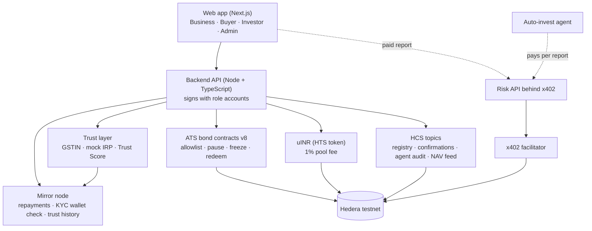
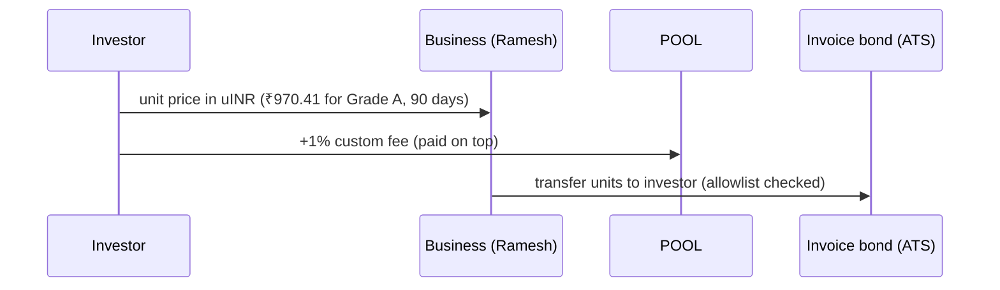
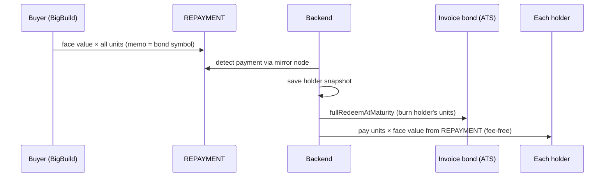
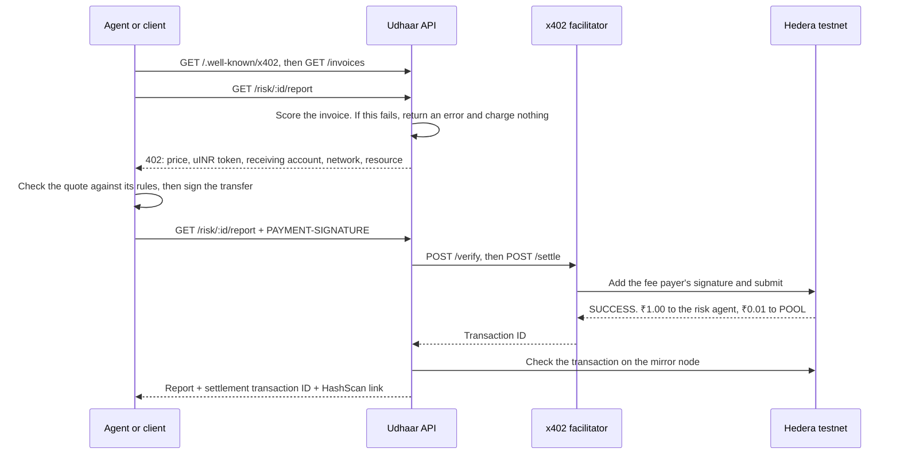

# Udhaar — invoice financing on Hedera

**Get paid for an invoice today, not in 90 days. Then pay your own suppliers with the same invoice.**

- **Problem:** Indian MSMEs often wait 60 to 90 days for large buyers to pay (the MSMED Act says 45), yet need cash now for wages and stock. Banks rarely lend to them without collateral.
- **Solution:** a buyer-confirmed invoice becomes an **ATS bond token** (Hedera's Asset Tokenization Studio). KYC-approved investors fund it today at a discount, and are repaid automatically when the buyer pays.
- **Wow:** the supplier can **pay his own suppliers with the token**, which reaches the small firms that today's invoice-discounting platforms skip.

Built solo at **ETHGlobal Mumbai 2026** for the Hedera tracks *Tokenize Anything with Hedera Studios* and *AI Agents That Pay: x402 on Hedera*.

### For judges: the 60-second tour

| You want to | Go to |
|---|---|
| Try it yourself | [udhaar-teal.vercel.app](https://udhaar-teal.vercel.app) (pick a persona on the login page) |
| See it in 4 minutes | [Demo video](https://www.youtube.com/watch?v=MzwFGgrLNO4) |
| Check every track requirement | [Track checklist](#track-checklist) |
| See real transactions on HashScan | [Proof on Hedera testnet](#proof-on-hedera-testnet) |
| See a repayment that ran by itself | [Scheduled repayment](#scheduled-repayment) |
| Know what is real and what is mocked | [Real vs mock](#what-is-real-and-what-is-a-mock) |
| See our contribution back to ATS | [hashgraph/asset-tokenization-studio#1412](https://github.com/hashgraph/asset-tokenization-studio/pull/1412) |

> ⚠️ **Testnet demo with simulated data.** Companies, people, KYC, GST and bureau data, and invoices are fictional. All Hedera transactions are real testnet transactions. Not real money.

---

## Demo

- **Demo video:** [Watch on YouTube](https://www.youtube.com/watch?v=MzwFGgrLNO4)
- **Live app:** [udhaar-teal.vercel.app](https://udhaar-teal.vercel.app) (Hedera testnet; pick a persona on the login page)

Six personas, each a real testnet account (three of them buyers). Pick one on the login page, or switch in the header:

| Persona | Role | What they do |
|---|---|---|
| **Ramesh** | Business (cement supplier) | Uploads an invoice, sees its status, receives funding, pays his own supplier with invoice units |
| **BigBuild** | Buyer (construction company) | Confirms the invoice on-chain, then repays once on the due date |
| **Apex Infra** | Buyer, a good payer (mock profile: bureau 780, no dues or complaints) | Same as BigBuild, with its own account and key. Its portal shows only its own invoices |
| **Nova Retail** | Buyer, a risky payer (mock profile: bureau 610, over ₹10 lakh of MSME-1 dues, 4 complaints) | Same, so an invoice owed by Nova shows a low buyer score and warnings in the trust check |
| **Priya** | Investor | Completes KYC, reads a paid risk report, buys units, or sets rules for the auto-invest agent |
| **Operator** | Admin (passcode) | Approves KYC, issues the bond token, pauses or freezes it, sees the audit log |

## How it works

One invoice, end to end. This is the run in the demo video, **INV-0048** (bond [`0.0.11342882`](https://hashscan.io/testnet/contract/0.0.11342882)); the step-by-step transaction table under [Proof](#proof-on-hedera-testnet) is the earlier INV-0001 run:

1. **Upload.** Ramesh uploads a ₹1,00,000 invoice owed by BigBuild Ltd, due in 90 days. Udhaar refuses a tampered e-invoice QR or an amount over the new-company limit, then writes the invoice's fingerprint to a public **HCS registry**. An invoice that was already financed is rejected.
2. **Buyer confirms.** BigBuild posts a message to an HCS topic, signed by its own account, saying it owes the amount.
3. **Risk check.** The risk engine scores the buyer. BigBuild gets **Grade A**, which earns investors **12% a year**.
4. **Tokenize.** The admin issues an ATS bond: **100 units of ₹1,000 face value**, maturity on the due date, allowlist-only transfers. All 100 units go to Ramesh.
5. **Investors buy.** Priya is KYC-approved first: the operator's KYC card shows a **wallet check** read from the mirror node (a warning if the account is under 7 days old or its latest 100 transfers touch a blocklisted account; the blocklist is mock data), and approving with warnings asks for confirmation. Then Priya pays **₹970.41 per unit** in uINR (a test rupee stablecoin), so Ramesh receives **₹97,041 today**. A 1% fee goes on top to an investor protection pool.
6. **Pay your supplier.** Ramesh sends 20 units to his sand supplier, Shree Sand Traders, as payment for sand. The token rejects any recipient who isn't KYC-verified.
7. **Controls.** If something looks wrong, the operator **pauses** the token or **freezes** units on one holder.
8. **Repayment.** At maturity BigBuild pays ₹1,00,000 to a REPAYMENT account, by itself through a [Hedera scheduled transaction](#scheduled-repayment) or with the manual Pay button. The backend sees it on the mirror node, then for every holder **burns their units first and pays them second**: ₹1,000 per unit, fee-free. Priya turns ₹970.41 per unit into ₹1,000.

### How the price is set

The discount depends on how long the investor waits, not on a flat percentage:

```
discount % = annual rate × days to the due date / 365
unit price = face value × (1 − discount % / 100)
```

| Grade | Rate a year | ₹1,000 unit, due in 90 days |
|---|---:|---:|
| A (score 80+) | 12% | **₹970.41** (2.9589% off) |
| B (65–79) | 16% | ₹960.55 |
| C (50–64) | 20% | ₹950.69 |
| D (under 50) | Not listed | Refused |

For INV-0042: 12% × 90 / 365 = 2.9589%, so ₹1,000 × (1 − 0.029589) = **₹970.41**. A shorter invoice gets a smaller discount.

> **Older invoices:** INV-0001 to INV-0005 were tokenized before time-based pricing and used a **flat 4%** (₹960 per unit). They keep that price.

### Scheduled repayment

Once a bond exists, the server creates a Hedera `ScheduleCreateTransaction`, signed by the buyer's key. It wraps a uINR transfer of the full repayment from the buyer to REPAYMENT, with the same memo as the manual route. Its expiry is the bond's maturity and wait-for-expiry is on, so the network runs the transfer at maturity with no one pressing anything. The schedule ID is saved on the invoice and every portal shows "Repayment scheduled on Hedera" with its HashScan link, then the outcome.

- **The 62-day limit:** the network refuses an expiry more than 62 days away (checked on testnet: 61.5 days worked, 63 failed with `SCHEDULE_EXPIRATION_TIME_TOO_FAR_IN_FUTURE`). A bond maturing later is scheduled by a check that runs every 30 seconds, once its maturity is within 62 days (less an hour).
- **After it runs:** the same check finds the payment on the mirror node and runs the existing repayment, burn first and pay second.
- **If it fails** (for example the buyer lacks the uINR), the invoice shows "Scheduled repayment failed" and the manual repay route works as before. Manual repay also waits for a schedule that is due, so a buyer is never charged twice.
- **Turn the check off** on a test server with `SCHEDULE_WATCHER=off`.

## Trust: is the business real, is the invoice real, will the money come back?

This is the question every investor asks, so each part has a check you can see in the app (`GET /trust/:invoiceId` returns the whole checklist).

| Question | How Udhaar answers it |
|---|---|
| **Is the business real?** | Both GSTINs are checked for format, state code and checksum, then looked up in the **GST registry** (status Active, legal name matches, last 6 returns filed). The seller's Udyam number is format-checked |
| **Is the invoice real?** | A **mock IRP-signed e-invoice** QR (ES256) is checked against the invoice's GSTINs, number, amount and date. The **buyer's confirmation** is a signed HCS message, verified as posted by the buyer's own account. A **duplicate-invoice registry** on HCS rejects an invoice that was already financed |
| **Will the money come back?** | The **Udhaar Trust Score** (300–900) for the seller and for the buyer |

**The investor's real risk is the buyer.** The supplier already delivered the goods, so what matters is whether the buyer pays. The risk grade is therefore built on the buyer's payment record, and a fraud flag (billing loop, shared director, shared address) forces Grade D, which can't be tokenized. The trust checklist shows investors every pass, warning and fail (cancelled GSTIN, name mismatch and so on) before they buy; a tampered e-invoice or an amount over the new-company limit is refused at upload.

**What goes into the Trust Score** (out of 100 points, mapped to 300–900):

| Factor | Points | Source |
|---|---:|---|
| Payment history | 40 | **On-chain repayments** read from the mirror node. On time means paid by the end of the due day |
| Company profile | 25 | Age, GST filing rate, size (mock) |
| External obligations | 20 | MSME-1 dues over 45 days and Samadhaan complaints (mock) |
| Network | 15 | How promptly the company pays its other suppliers (mock) |

Payment history is not self-reported. Each repayment is a transaction the server fetches and checks: it succeeded, it was a uINR payment from the buyer, and its consensus time is compared with the due date.

**Cold start.** A company with no repayments on Udhaar shows **"New on Udhaar"**. Its payment-history points come from the outside (mock) bureau profile, and every invoice it is part of is **capped at ₹1,00,000 until it has 3 on-time repayments**. A late repayment doesn't count toward the 3.

### What is real and what is a mock

| Real on Hedera today | Mock of a production integration |
|---|---|
| ATS bond issue, allowlist, transfer, pause, freeze, redemption | **GST registry** (a real build would use a GST Suvidha Provider API) |
| uINR token, 1% fee, exempt repayment collector | **E-invoice signer** (stands in for the government's IRP; key in `backend/deployments/mock-irp-public.json`) |
| HCS invoice registry, buyer confirmations, agent audit log | **Credit bureau scores and ratings** |
| Buyer repayments used for the Trust Score | **MSME-1 dues** and **MSME Samadhaan complaints** |
| x402 payments for risk reports | KYC, company records and the risk dataset (simulated) |

Every mock record and API response says `mock`. Details are in [`docs/DATA.md`](docs/DATA.md#trust-data-mock).

## Architecture



| Layer | Choice |
|---|---|
| Frontend | Next.js, Tailwind, shadcn-style components |
| Backend | Node + TypeScript, Express, `@hiero-ledger/sdk` |
| Tokenization | ATS contracts `@hashgraph/asset-tokenization-contracts@8.0.0`, called directly with `ContractExecuteTransaction` (the ATS SDK only signs through wallets) |
| Payments | uINR, an HTS fungible token created with the Hedera SDK |
| Records | HCS topics and the Hedera mirror node REST API |

### Payment flows

**Buying units**



**Repayment at maturity**



## Hedera services used

| Service | What Udhaar uses it for |
|---|---|
| **Asset Tokenization Studio (ATS) bonds**, v8 factory `0.0.9213391` | One bond per invoice. Operations used: `deployBond` (factory), `addToControlList` (allowlist), `issue`, `transfer`, `pause` / `unpause`, `freezePartialTokens` / `unfreezePartialTokens`, `fullRedeemAtMaturity` (burn at repayment) |
| **HTS: uINR** `0.0.11327250` | Test rupee stablecoin, 2 decimals. Fee schedule: **1% to POOL, paid by the sender on top**, plus a zero-charge second row that makes **REPAYMENT an exempt fee collector**, so repayments and payouts carry no fee. No admin key |
| **HCS topics** | `registryTopicId` `0.0.11327836` (invoice fingerprints, duplicate guard), `confirmationTopicId` `0.0.11327838` (signed buyer confirmations), `agentAuditTopicId` `0.0.11332556` (every agent payment and decision; only the investor's key can write, no admin key) |
| **Scheduled Transactions** | One `ScheduleCreateTransaction` per bond: the buyer's uINR repayment to REPAYMENT, expiring at maturity with wait-for-expiry on, so it executes with no button pressed. See [Scheduled repayment](#scheduled-repayment) |
| **HCS: Udhaar NAV feed** | A daily NAV per token for every tokenized invoice, published to its own topic (admin key only), plus on demand with `POST /nav/publish`. NAV = face value × (1 − annual rate × days remaining / 365), from the same pricing code as the issue price. An overdue invoice gets no price. `GET /nav/:invoiceId` is free. Topic `navTopicId` `0.0.11337348` ([HashScan](https://hashscan.io/testnet/topic/0.0.11337348)), saved in `backend/deployments/hcs.json`. Bonds tokenized before grades were saved (INV-0002 to 0005) have no rate to work from and are skipped |
| **Mirror node** | Checks a KYC applicant's wallet (account age, and its latest 100 transfers against a mock blocklist, before admin approval), detects buyer repayments, reads on-chain repayment history for the Trust Score, verifies x402 settlements, reads topic messages |
| **x402 with the facilitator** | Pay-per-call risk reports in uINR, settled through `https://x402.org/facilitator`, which pays the HBAR fee. Packages `@x402/core` and `@x402/hedera` |
| **HashPack via WalletConnect** | The web app connects a HashPack wallet, **read-only** for now: it shows the wallet but doesn't sign. Demo trades are signed by pre-funded personas |

## x402 payment flow and the auto-invest agent

The full risk report costs **₹1.00 in uINR** per call, with no account, API key or subscription. The auto-invest agent pays for reports itself, within rules the investor sets, and buys the invoices that pass. Payments settle on Hedera testnet through the [official x402 facilitator](https://docs.hedera.com/solutions/ai/x402/facilitators).



### Settled payments

**Facilitator:** `https://x402.org/facilitator`. **Token:** uINR [`0.0.11327250`](https://hashscan.io/testnet/token/0.0.11327250). **Receiving account:** the risk agent, [`0.0.11310322`](https://hashscan.io/testnet/account/0.0.11310322).

| Payment | Hedera transaction ID | HashScan |
|---|---|---|
| Paid call, risk report for INV-0004 | `0.0.9185802@1793927733.569018473` | [view](https://hashscan.io/testnet/transaction/1793927735.682721440) |
| `POST /risk/:id/buy-report`, DEMO-LATE | `0.0.9185802@1793927745.799828164` | [view](https://hashscan.io/testnet/transaction/1793927747.010064224) |
| Agent, risk report for INV-0002 | `0.0.9185802@1793927753.817921059` | [view](https://hashscan.io/testnet/transaction/1793927756.562557250) |
| Agent, risk report for INV-0004 | `0.0.9185802@1793927788.446751855` | [view](https://hashscan.io/testnet/transaction/1793927793.282445551) |
| Agent, risk report for DEMO-RING | `0.0.9185802@1793927805.350047960` | [view](https://hashscan.io/testnet/transaction/1793927808.744609276) |

Each one moved 1.01 uINR from the investor: 1.00 to the risk agent and 0.01 to POOL, through the token's HTS custom fee.

### One agent run

Rules: report budget ₹5, investment budget ₹5,000, minimum grade B, at most 110 units per invoice. The investor already held 100 units of INV-0002. (These invoices were tokenized before time-based pricing, so they use the old flat 4%, ₹960 per unit.)

| Invoice | Report | Result |
|---|---|---|
| INV-0002 | Paid. Grade A, score 91 | **Bought 5 units** at ₹960 for ₹4,848 including the fee ([payment](https://hashscan.io/testnet/transaction/1793927777.544166104), [units](https://hashscan.io/testnet/transaction/1793927781.142343851)) |
| INV-0003 | Not bought | Skipped: the bond has matured |
| INV-0004 | Paid. Grade B, score 72 | Skipped: anomaly warning, 39× the supplier's usual amount |
| INV-0005 | Not bought | Skipped: the bond has matured |
| DEMO-RING | Paid. Grade D, score 49 | Skipped: circular invoicing fraud |

It spent ₹3.03 on reports and ₹4,848 on units, and no person approved anything after the run started. Every payment and decision is in the HCS audit log, topic [`0.0.11332556`](https://hashscan.io/testnet/topic/0.0.11332556).

### Spending controls

The agent's rules are plain code (`backend/src/agent/rules.ts`), with no LLM involved:

- **Budgets:** separate limits for reports and for units, per run, both counting the 1% fee.
- **Allowlist:** it only pays the risk agent, in uINR, on testnet, and never more than ₹2 for a report, whatever the server quotes.
- **Investment rules:** a minimum grade and a maximum position per invoice. Fraud flags and anomaly warnings are always skipped.
- **Audit first:** if the HCS log fails, the run stops rather than spending unlogged.
- **Limits on runs:** per-IP rate limits, a daily cap, and server-side maximums on the rules.
- **Replay protection:** one payment buys one report, and the server checks the transaction on-chain before releasing it.

Try it (server running, see [Run it locally](#run-it-locally)):

```bash
curl -i http://localhost:4000/risk/DEMO-RING/report   # 402 with the price
TOKEN=$(curl -s -X POST http://localhost:4000/auth/demo-investor | node -pe "JSON.parse(require('fs').readFileSync(0)).token")
curl -X POST http://localhost:4000/agent/run -H "Authorization: Bearer $TOKEN" -H "Content-Type: application/json" \
  -d '{"reportBudget":5,"investmentBudget":5000,"minGrade":"B","maxUnitsPerInvoice":110}'
```

The facilitator is public and needs no API key. To use another, set `FACILITATOR_URL`, such as `https://api.testnet.blocky402.com`. Routes are in [`docs/API.md`](docs/API.md#risk). The code is in `backend/src/x402/` and `backend/src/agent/`.

**Limits of this demo:** the investor session has no passcode, so anyone who can reach the server can start a run, within the limits above. The backend holds the investor's key, so a real product would have investors sign or delegate from their own wallets.

## Proof on Hedera testnet

**Core contracts and tokens**

| Item | ID |
|---|---|
| ATS factory (v8) | [0.0.9213391](https://hashscan.io/testnet/contract/0.0.9213391) |
| ATS resolver | [0.0.9212226](https://hashscan.io/testnet/contract/0.0.9212226) |
| uINR stablecoin | [0.0.11327250](https://hashscan.io/testnet/token/0.0.11327250) |
| POOL (1% fee collector) | [0.0.11327247](https://hashscan.io/testnet/account/0.0.11327247) |
| REPAYMENT (exempt collector) | [0.0.11327249](https://hashscan.io/testnet/account/0.0.11327249) |
| Apex Infra Pvt Ltd (buyer, good payer) | [0.0.11339577](https://hashscan.io/testnet/account/0.0.11339577) |
| Nova Retail (buyer, risky payer) | [0.0.11339578](https://hashscan.io/testnet/account/0.0.11339578) |
| HCS invoice registry | [0.0.11327836](https://hashscan.io/testnet/topic/0.0.11327836) |
| HCS buyer confirmations | [0.0.11327838](https://hashscan.io/testnet/topic/0.0.11327838) |
| HCS agent audit log | [0.0.11332556](https://hashscan.io/testnet/topic/0.0.11332556) |
| HCS NAV feed | [0.0.11337348](https://hashscan.io/testnet/topic/0.0.11337348) |
| NAV published for INV-0006 (999.56) | [1793958355.504763920](https://hashscan.io/testnet/transaction/1793958355.504763920) |
| NAV published for INV-0007 (999.67) | [1793958358.878345104](https://hashscan.io/testnet/transaction/1793958358.878345104) |

**Trust layer proof**

| Item | Where |
|---|---|
| Mock IRP public key (verifies the signed e-invoice QRs) | [`backend/deployments/mock-irp-public.json`](backend/deployments/mock-irp-public.json), also `GET /mock-irp/public-key` |
| Trust checklist for any invoice, with HashScan links for the buyer confirmation and registry entry | `GET /trust/:invoiceId` |
| A company's Trust Score and its on-chain repayment history | `GET /trust/company/:id` |
| Sign a demo e-invoice | `POST /mock-irp/e-invoice` |

**Demo video run (invoice INV-0048)**

| Item | Link |
|---|---|
| Invoice bond (ATS) | [0.0.11342882](https://hashscan.io/testnet/contract/0.0.11342882) |
| NAV ₹970.41 published on the HCS NAV feed (90 days to maturity) | [1793985298.664793104](https://hashscan.io/testnet/transaction/1793985298.664793104) |

**Full lifecycle through the API (invoice INV-0001, bond [0.0.11327849](https://hashscan.io/testnet/contract/0.0.11327849))**

| Step | Transaction |
|---|---|
| Invoice hash recorded on HCS registry | [1793901595.385318041](https://hashscan.io/testnet/transaction/1793901595.385318041) |
| Buyer confirmation (signed HCS message) | [1793901608.498336960](https://hashscan.io/testnet/transaction/1793901608.498336960) |
| Deploy invoice bond | [1793901622.150899959](https://hashscan.io/testnet/transaction/1793901622.150899959) |
| Issue units to business | [1793901631.751262439](https://hashscan.io/testnet/transaction/1793901631.751262439) |
| KYC approval: investor added to allowlist | [1793901651.821071649](https://hashscan.io/testnet/transaction/1793901651.821071649) |
| Investor pays business in uINR (+1% to POOL) | [1793901679.193264309](https://hashscan.io/testnet/transaction/1793901679.193264309) |
| Units transferred to investor | [1793901682.601416104](https://hashscan.io/testnet/transaction/1793901682.601416104) |
| Pay your supplier: units to verified supplier | [1793901720.701418104](https://hashscan.io/testnet/transaction/1793901720.701418104) |
| Pay your supplier: unverified recipient rejected | [1793901732.845241104](https://hashscan.io/testnet/transaction/1793901732.845241104) |
| Pause / unpause | [pause](https://hashscan.io/testnet/transaction/1793901744.845194587) · [unpause](https://hashscan.io/testnet/transaction/1793901756.251101658) |
| Freeze / unfreeze holder units | [freeze](https://hashscan.io/testnet/transaction/1793901778.121317974) · [unfreeze](https://hashscan.io/testnet/transaction/1793901789.485222650) |
| Buyer repays REPAYMENT | [1793902071.425219380](https://hashscan.io/testnet/transaction/1793902071.425219380) |
| Business: burn 70 units → paid 70,000 uINR | [burn](https://hashscan.io/testnet/transaction/1793902096.685790104) · [payment](https://hashscan.io/testnet/transaction/1793902131.645744104) |
| Investor: burn 20 units → paid 20,000 uINR | [burn](https://hashscan.io/testnet/transaction/1793902290.785405104) · [payment](https://hashscan.io/testnet/transaction/1793902295.985719104) |
| Supplier: burn 10 units → paid 10,000 uINR | [burn](https://hashscan.io/testnet/transaction/1793902319.925784770) · [payment](https://hashscan.io/testnet/transaction/1793902325.105524104) |

**Scheduled repayment (demo-maturity ₹10,000 invoice, run on an isolated copy of the store, no button pressed):**

| Step | Proof |
|---|---|
| Schedule `0.0.11347101` created, signed by the buyer | [schedule](https://hashscan.io/testnet/schedule/0.0.11347101) · [create](https://hashscan.io/testnet/transaction/1794008212.374173160) |
| Scheduled execution at maturity: buyer pays REPAYMENT 10,000 uINR | [1794008541.008431804](https://hashscan.io/testnet/transaction/1794008541.008431804) |
| Business: burn 4 units → paid 4,000 uINR | [burn](https://hashscan.io/testnet/transaction/1794008567.888273418) · [payment](https://hashscan.io/testnet/transaction/1794008575.831080711) |
| Investor: burn 6 units → paid 6,000 uINR | [burn](https://hashscan.io/testnet/transaction/1794008580.241404776) · [payment](https://hashscan.io/testnet/transaction/1794008585.634191104) |

**uINR fee behaviour:** investor → business 1,000 uINR, with 10 uINR to POOL paid on top ([tx](https://hashscan.io/testnet/transaction/1793898088.735173764)); transfers into and out of REPAYMENT pay no fee.

## Track checklist

**Tokenize Anything with Hedera Studios**

| Requirement | Where it's met |
|---|---|
| Use ATS to issue and manage the asset | One ATS v8 bond per invoice, deployed through the factory (`backend/src/ats/bond.ts`) |
| Deploy and demo on Hedera testnet | [Proof](#proof-on-hedera-testnet) above: the INV-0048 run from the video, and the full INV-0001 lifecycle with every transaction. Live at [udhaar-teal.vercel.app](https://udhaar-teal.vercel.app) |
| Issuance, configuration, lifecycle operation | Issue, allowlist and roles, then redemption at maturity, freeze and pause |
| Compliance controls | KYC allowlist, a KYC wallet check (account age and transfers against a mock blocklist, read from the mirror node), transfer restrictions, freeze, pause, GSTIN and e-invoice checks |
| Custom fees and distributions | 1% pool fee on uINR; repayment paid to every holder |
| Scheduled Transactions | ✅ When a bond is issued, a `ScheduleCreateTransaction` wraps the buyer's uINR repayment to REPAYMENT, set to expire at maturity and wait for that expiry, so it runs on its own. A bond maturing beyond the network's 62-day limit is scheduled by a periodic check once it is within it. The existing repayment then burns and pays as usual. If the schedule fails, manual repay stays open ([details](#scheduled-repayment)) |
| Contribution back to ATS | ✅ Opened [hashgraph/asset-tokenization-studio#1412](https://github.com/hashgraph/asset-tokenization-studio/pull/1412), a developer guide for server-side (headless) signing that answers open issue #1397; the guide is also at [`docs/ats-server-side-signing.md`](docs/ats-server-side-signing.md) |
| Contracts verified on HashScan (where applicable) | No custom Solidity was written. Every bond is deployed by the official ATS v8 factory [`0.0.9213391`](https://hashscan.io/testnet/contract/0.0.9213391) |
| Oracle pricing / NAV feed | A daily NAV per token on the HCS topic [`0.0.11337348`](https://hashscan.io/testnet/topic/0.0.11337348) (`GET /nav/:invoiceId`, `POST /nav/publish`; NAV and its HCS proof are also in the paid risk report) |
| Public repo, video of 5 minutes or less | Public GitHub repo. Video: [watch on YouTube](https://www.youtube.com/watch?v=MzwFGgrLNO4) |

**AI Agents That Pay: x402 on Hedera**

| Requirement | Where it's met |
|---|---|
| x402-protected endpoint settling on Hedera | `GET /risk/:id/report`, ₹1.00 in uINR ([flow](#x402-payment-flow-and-the-auto-invest-agent)) |
| Agent pays with no human approving | `POST /agent/run`, [one agent run](#one-agent-run) |
| Settled transaction ID in the README | [Settled payments](#settled-payments) |
| Setup, architecture, payment flow | This README |
| Extras beyond the requirements | A daily NAV feed on HCS, and the buyer's repayment run by a Hedera [scheduled transaction](#scheduled-repayment) so the whole lifecycle can finish with no human action |
| Video of 5 minutes or less | [Watch on YouTube](https://www.youtube.com/watch?v=MzwFGgrLNO4) |

## Run it locally

**Prerequisites:** Node.js 20+ (24 recommended), Hedera testnet ECDSA accounts with HBAR.

```bash
git clone https://github.com/adityagavane47/udhaar.git
cd udhaar
```

Create `.env` in the repo root (never commit it; it is in `.gitignore`). Variable names only:

```
# One account ID and private key per role
ADMIN_ID=        ADMIN_KEY=
BUSINESS_ID=     BUSINESS_KEY=
BUYER_ID=        BUYER_KEY=
# The two extra buyers. Made for you, and written to .env, by: cd backend && npm run create-buyer-accounts
APEX_ID=         APEX_KEY=
NOVA_ID=         NOVA_KEY=
INVESTOR_ID=     INVESTOR_KEY=
RISK_AGENT_ID=   RISK_AGENT_KEY=
POOL_ID=         POOL_KEY=
REPAYMENT_ID=    REPAYMENT_KEY=

# Admin login for the demo
DEMO_ADMIN_PASSCODE=
# Optional, demo only: minutes (3 to 1440) for the admin "Demo: short maturity" option
# DEMO_SHORT_MATURITY_MINUTES=

# Signs the mock e-invoices. Created by: cd backend && npm run generate-irp-key
MOCK_IRP_PRIVATE_KEY=
```

Optional settings (`FACILITATOR_URL`, `MAX_STEP_HBAR`, `DATA_DIR`, rate and agent limits) are listed in [`docs/API.md`](docs/API.md#server-settings).

**Backend** (port 4000):

```bash
cd backend
npm install
npm run generate-irp-key   # once; writes MOCK_IRP_PRIVATE_KEY to .env without printing it
npm start
```

**Frontend** (port 3000). Put these in `web/.env.local`:

```
NEXT_PUBLIC_API_URL=http://localhost:4000
NEXT_PUBLIC_WALLETCONNECT_PROJECT_ID=    # from cloud.reown.com; needed only for the HashPack panel
NEXT_PUBLIC_USE_MOCK=                    # set to true only to run the UI without the backend
```

```bash
cd web
npm install
npm run dev
```

**Demo maturity.** To show repayment live, set `DEMO_SHORT_MATURITY_MINUTES` (3 to 1440) in `.env`. The admin then sees a "Demo: short maturity" checkbox on Create token, and the bond matures that many minutes from now. Pricing and NAV still use the real days to the due date, which must be at least tomorrow, so the bond is priced close to face value. Every such bond is labelled "Demo maturity" in every portal, and the buyer's Pay button appears once it has matured.

**Reset for a recording** (in `backend/`, with the backend stopped): `npm run demo:reset` backs up the data directory to `backend/data/backups/<timestamp>`, archives every invoice, agent run and audit entry (hidden from lists, still found by ID, so duplicate checks, trust history, NAV and paid reports keep working), makes the next invoice INV-0042, and sets the investor's KYC back to pending. It sends no transactions. `npm run demo:restore <backup>` undoes it.

**Tests** (in `backend/`): `npm run test:risk`, `test:trust`, `test:nav`, `test:buyers`, `test:wallet-check`, `test:demo-maturity` and `test:demo-reset` spend no HBAR. `npm run test:x402` uses a fake facilitator and spends nothing. `npm run test:api`, `test:auth` and `test:x402:live` use the real testnet and spend HBAR.

One-off setup scripts (already run for this deployment): `npm run issue-bond`, `npm run create-stablecoin`, `npm run create-buyer-accounts` (the Apex and Nova accounts, written to `.env`) and `npm run add-buyer-companies` (their mock company data). Routes are documented in [`docs/API.md`](docs/API.md).

## Repository layout

```
backend/   API service, ATS / HTS / HCS modules, risk and trust layers, scripts, deployment records
web/       Next.js frontend: landing page and four portals
docs/      PRD, overview, API reference, data notes, AI usage, prompts, ATS PR notes
```

## Design decisions

- **Contracts, not the ATS SDK:** the SDK signs only through wallets, so the backend calls the v8 contracts directly and signs with the Hedera SDK. We contributed this approach back to ATS (#1412).
- **Invoice = bond:** an invoice bought at a discount and repaid at face value on a due date behaves like a zero-coupon bond, so the ATS bond type fits.
- **Burn first, then pay:** units are burned from a saved holder snapshot before payment, so they can't move between payout and burn. Each payment is recorded, so a crash never pays anyone twice.
- **Own stablecoin (uINR):** custom fees can't attach to ATS tokens, but they can attach to an HTS payment token. REPAYMENT is an exempt fee collector, so repayments and payouts are fee-free.
- **One registry for duplicates:** invoice fingerprints on a public HCS topic let anyone check whether an invoice was already financed.
- **Errors, not fallbacks:** if a risk or trust check fails, the API returns an error. It never returns a default "safe" score.

## Limitations and next steps

- **Custodial demo personas:** the backend holds all role keys so judges can click through without a wallet. Next: investors and businesses sign from their own wallets (HashPack is connected read-only today).
- **Mocks:** the GST registry, IRP e-invoicing, credit bureau scores, MSME-1 dues, MSME Samadhaan complaints, the company data behind the Apex and Nova buyers, and the wallet-check blocklist are mocks. Next: a GST Suvidha Provider API, the real IRP, a credit bureau and the MSME portals.
- **A scheduled repayment is a payment, not a guarantee:** the schedule runs only if the buyer holds enough uINR at maturity. If not, the invoice shows "Scheduled repayment failed" and the manual repay route stays open.
- **Account Aggregator:** read a business's bank data with consent, to check cash flow and confirm payments.
- **Regulation:** retail tokenized securities aren't permitted in mainland India today. The realistic path is a technology layer for a licensed NBFC-factor or TReDS platform, tested in an RBI or IFSCA (GIFT City) sandbox.
- **Risk data:** the risk dataset is simulated and the scorecard is hand-tuned, so no weight has been checked against real defaults. See [`docs/DATA.md`](docs/DATA.md#limits).
- **Storage:** the backend uses a JSON store, which needs a persistent disk when hosted.

## Built with AI

Claude Code built the backend (Hedera integration, risk and trust layers, x402 and agent) and parts of the frontend. Google Antigravity (Gemini) built most of the frontend. Claude was also used for research and documentation. I set the product decisions, wrote the specs, and reviewed every diff and every on-chain result. Prompts and specs are in [`docs/`](docs/); the split, the rules and how output was tested are in [`docs/AI_USAGE.md`](docs/AI_USAGE.md), and the main prompts in [`docs/prompts.md`](docs/prompts.md).

## Author

**Aditya Gavane**, VIT Pune · [GitHub](https://github.com/adityagavane47)

## License

MIT. See [`LICENSE`](LICENSE). Copyright (c) 2026 Aditya Gavane.
