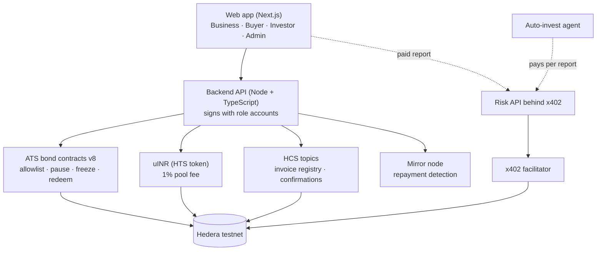
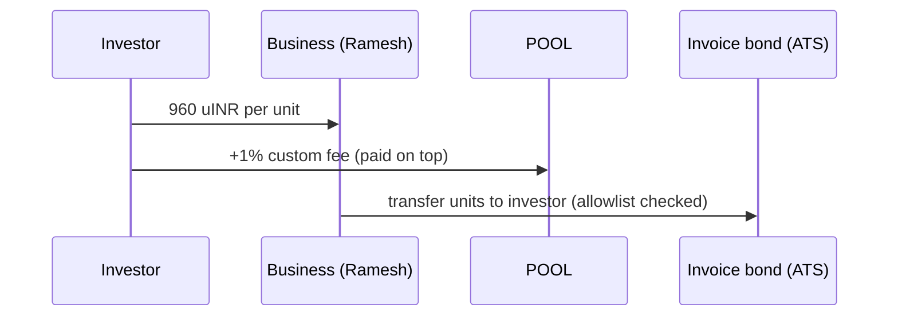
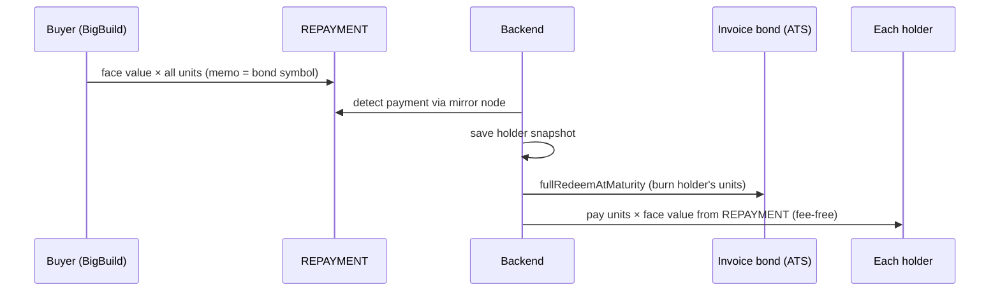
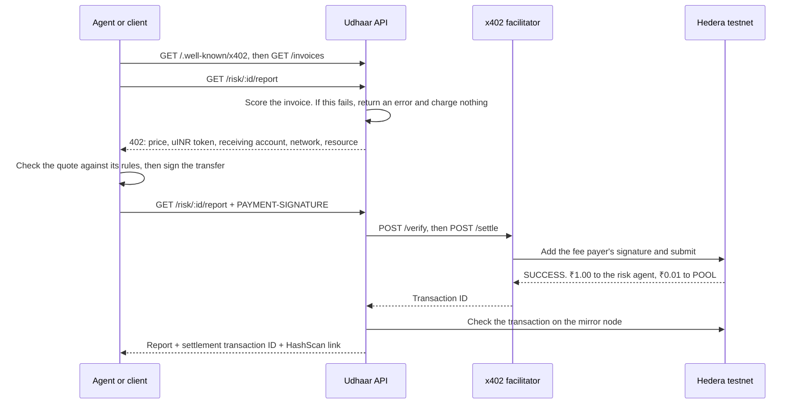

# Udhaar — invoice financing on Hedera

**Turn an unpaid invoice into cash today, and let it pay your own suppliers too.**

Udhaar tokenizes buyer-confirmed invoices as compliant security tokens with Hedera's **Asset Tokenization Studio (ATS)**. KYC-verified investors buy them at a discount, so the supplier is paid today instead of in 90 days. The supplier can also **pass part of the invoice token down to his own suppliers as payment**, reaching small firms that today's invoice-discounting platforms don't. When the buyer pays, every holder is repaid automatically, and every step is provable on HashScan.

Built solo at **ETHGlobal Mumbai 2026** for the Hedera tracks *Tokenize Anything with Hedera Studios* and *AI Agents That Pay: x402 on Hedera*.

> ⚠️ **Testnet demo with simulated data.** Companies, people, KYC and invoices are fictional. All Hedera transactions are real testnet transactions. Not real money.

---

## The problem

- Indian MSMEs were owed about **₹7.34 lakh crore in delayed payments** as of March 2024, and micro firms wait the longest ([Delayed Payments Report 3.0](https://smestreet.in/infocus/delayed-payments-report-30-highlights-msme-finance-progress-10816194)).
- The MSME credit gap is about **₹30 lakh crore** ([SIDBI](https://www.freepressjournal.in/business/msme-sector-30-lakh-crore-credit-gap-says-sidbi-report)).
- RBI-licensed TReDS platforms finance the **direct** supplier of a large buyer, but not the smaller firms that supply *him*. Experts call this the deep-tier finance gap ([GTR](https://www.gtreview.com/magazine/the-supply-chain-issue-2024/deep-tier-supply-chain-finance-what-it-is-and-why-it-matters)).

## How it works

1. **Upload.** Ramesh, a cement supplier, uploads a ₹5,00,000 invoice owed by BigBuild Ltd. Its fingerprint is checked against a public **HCS registry**, so an invoice that was already financed is rejected.
2. **Buyer confirms.** BigBuild confirms the debt with an **HCS message signed by its own account**.
3. **Tokenize.** The invoice becomes an **ATS bond**: units of ₹1,000 face value, maturity on the due date, **allowlist-only** transfers. All units are issued to Ramesh.
4. **Investors buy.** KYC-approved investors buy units at a discount (₹960 for ₹1,000), paying in **uINR**, our test rupee stablecoin. 1% of each funding goes to an **investor protection pool** via an HTS custom fee.
5. **Pay your supplier.** Ramesh transfers units to Suresh, his sand supplier. The token contract rejects any unverified recipient.
6. **Controls.** The operator can **pause** the whole token or **freeze** units on one holder.
7. **Repayment.** BigBuild pays the full amount to a REPAYMENT account. The backend detects it on the **mirror node**, then for every holder **burns their units first and pays them second** (face value × units), fee-free and safe against crashes or double payment.

## Architecture



| Layer | Choice |
|---|---|
| Frontend | Next.js, Tailwind, shadcn-style components |
| Backend | Node + TypeScript, Express, `@hiero-ledger/sdk` |
| Tokenization | ATS contracts `@hashgraph/asset-tokenization-contracts@8.0.0`, called directly with `ContractExecuteTransaction` (the ATS SDK only signs through wallets) |
| Payments | uINR, an HTS fungible token created with the Hedera SDK |
| Records | HCS topics and the Hedera mirror node REST API |

## Payment flows

**Buying units**



**Repayment at maturity**



## x402 payment flow

The full risk report costs **₹1.00 in uINR** per call, with no account, API key or subscription. The auto-invest agent pays for reports itself, within rules the investor sets, and buys the invoices that pass. Payments settle on Hedera testnet through the [official x402 facilitator](https://docs.hedera.com/solutions/ai/x402/facilitators), which pays the HBAR fee.



### Settled payments

**Facilitator:** `https://x402.org/facilitator`. **Token:** uINR [`0.0.11327250`](https://hashscan.io/testnet/token/0.0.11327250). **Receiving account:** the risk agent, [`0.0.11310322`](https://hashscan.io/testnet/account/0.0.11310322).

| Payment | Hedera transaction ID | HashScan |
|---|---|---|
| Paid call, risk report for INV-0004 | `0.0.9185802@1793927733.569018473` | [view](https://hashscan.io/testnet/transaction/1793927735.682721440) |
| `POST /risk/:id/buy-report`, DEMO-LATE | `0.0.9185802@1793927745.799828164` | [view](https://hashscan.io/testnet/transaction/1793927747.010064224) |
| Agent, risk report for INV-0002 | `0.0.9185802@1793927753.817921059` | [view](https://hashscan.io/testnet/transaction/1793927756.562557250) |
| Agent, risk report for INV-0004 | `0.0.9185802@1793927788.446751855` | [view](https://hashscan.io/testnet/transaction/1793927793.282445551) |
| Agent, risk report for DEMO-RING | `0.0.9185802@1793927805.350047960` | [view](https://hashscan.io/testnet/transaction/1793927808.744609276) |

Each one moved 1.01 uINR from the investor: 1.00 to the risk agent and 0.01 to POOL, through the token's HTS custom fee.

### One agent run

Rules: report budget ₹5, investment budget ₹5,000, minimum grade B, at most 110 units per invoice. The investor already held 100 units of INV-0002.

| Invoice | Report | Result |
|---|---|---|
| INV-0002 | Paid. Grade A, score 91 | **Bought 5 units** at ₹960 for ₹4,848 including the fee ([payment](https://hashscan.io/testnet/transaction/1793927777.544166104), [units](https://hashscan.io/testnet/transaction/1793927781.142343851)) |
| INV-0003 | Not bought | Skipped: the bond has matured |
| INV-0004 | Paid. Grade B, score 72 | Skipped: anomaly warning, 39× the supplier's usual amount |
| INV-0005 | Not bought | Skipped: the bond has matured |
| DEMO-RING | Paid. Grade D, score 49 | Skipped: circular invoicing fraud |

It spent ₹3.03 on reports and ₹4,848 on units, and no person approved anything after the run started. Every payment and decision is in the HCS audit log, topic [`0.0.11332556`](https://hashscan.io/testnet/topic/0.0.11332556). Only the investor's key can write to that topic, and it has no admin key, so messages can't be changed or deleted.

### Spending controls

The agent's rules are plain code (`backend/src/agent/rules.ts`), with no LLM involved:

- **Budgets:** separate limits for reports and for units, per run, both counting the 1% fee.
- **Allowlist:** it only pays the risk agent, in uINR, on testnet, and never more than ₹2 for a report, whatever the server quotes.
- **Investment rules:** a minimum grade and a maximum position per invoice. Fraud flags and anomaly warnings are always skipped.
- **Audit first:** if the HCS log fails, the run stops rather than spending unlogged.
- **Limits on runs:** per-IP rate limits, a daily cap, and server-side maximums on the rules.
- **Replay protection:** one payment buys one report, and the server checks the transaction on-chain before releasing it.

### Run it

Nothing extra is needed beyond the setup below, because the facilitator is public and needs no API key. The investor needs uINR, but no HBAR for report payments. To use another facilitator, set `FACILITATOR_URL`, such as `https://api.testnet.blocky402.com`.

```bash
cd backend
npm run test:x402       # Paywall, sessions and agent rules, with a fake facilitator. Spends nothing
npm run test:x402:live  # Stop your server first. Real payments, a real purchase and an agent run, about 0.7 HBAR
```

```bash
# With the server running
curl -i http://localhost:4000/risk/DEMO-RING/report   # 402 with the price
TOKEN=$(curl -s -X POST http://localhost:4000/auth/demo-investor | node -pe "JSON.parse(require('fs').readFileSync(0)).token")
curl -X POST http://localhost:4000/agent/run -H "Authorization: Bearer $TOKEN" -H "Content-Type: application/json" \
  -d '{"reportBudget":5,"investmentBudget":5000,"minGrade":"B","maxUnitsPerInvoice":110}'
```

Routes are in [`docs/API.md`](docs/API.md#risk). The code is in `backend/src/x402/` and `backend/src/agent/`.

**Limits of this demo:** the investor session has no passcode, so anyone who can reach the server can start a run, within the limits above. The backend holds the investor's key, so a real product would have investors sign or delegate from their own wallets. Report grades come from the simulated dataset.

## Proof on Hedera testnet

**Core contracts and tokens**

| Item | ID |
|---|---|
| ATS factory (v8) | [0.0.9213391](https://hashscan.io/testnet/contract/0.0.9213391) |
| ATS resolver | [0.0.9212226](https://hashscan.io/testnet/contract/0.0.9212226) |
| uINR stablecoin | [0.0.11327250](https://hashscan.io/testnet/token/0.0.11327250) |
| POOL (1% fee collector) | [0.0.11327247](https://hashscan.io/testnet/account/0.0.11327247) |
| REPAYMENT | [0.0.11327249](https://hashscan.io/testnet/account/0.0.11327249) |
| HCS topics | see `backend/deployments/hcs.json` |

**Full lifecycle through the API (invoice INV-0001, bond [0.0.11327849](https://hashscan.io/testnet/contract/0.0.11327849))**

| Step | Transaction |
|---|---|
| Invoice hash recorded on HCS registry | [1793901595.385318041](https://hashscan.io/testnet/transaction/1793901595.385318041) |
| Buyer confirmation (signed HCS message) | [1793901608.498336960](https://hashscan.io/testnet/transaction/1793901608.498336960) |
| Deploy invoice bond | [1793901622.150899959](https://hashscan.io/testnet/transaction/1793901622.150899959) |
| Issue units to business | [1793901631.751262439](https://hashscan.io/testnet/transaction/1793901631.751262439) |
| KYC approval: investor added to allowlist | [1793901651.821071649](https://hashscan.io/testnet/transaction/1793901651.821071649) |
| Investor pays business in uINR (+1% to POOL) | [1793901679.193264309](https://hashscan.io/testnet/transaction/1793901679.193264309) |
| Units transferred to investor | [1793901682.601416104](https://hashscan.io/testnet/transaction/1793901682.601416104) |
| Pay your supplier: units to verified supplier | [1793901720.701418104](https://hashscan.io/testnet/transaction/1793901720.701418104) |
| Pay your supplier: unverified recipient rejected | [1793901732.845241104](https://hashscan.io/testnet/transaction/1793901732.845241104) |
| Pause / unpause | [pause](https://hashscan.io/testnet/transaction/1793901744.845194587) · [unpause](https://hashscan.io/testnet/transaction/1793901756.251101658) |
| Freeze / unfreeze holder units | [freeze](https://hashscan.io/testnet/transaction/1793901778.121317974) · [unfreeze](https://hashscan.io/testnet/transaction/1793901789.485222650) |
| Buyer repays REPAYMENT | [1793902071.425219380](https://hashscan.io/testnet/transaction/1793902071.425219380) |
| Business: burn 70 units → paid 70,000 uINR | [burn](https://hashscan.io/testnet/transaction/1793902096.685790104) · [payment](https://hashscan.io/testnet/transaction/1793902131.645744104) |
| Investor: burn 20 units → paid 20,000 uINR | [burn](https://hashscan.io/testnet/transaction/1793902290.785405104) · [payment](https://hashscan.io/testnet/transaction/1793902295.985719104) |
| Supplier: burn 10 units → paid 10,000 uINR | [burn](https://hashscan.io/testnet/transaction/1793902319.925784770) · [payment](https://hashscan.io/testnet/transaction/1793902325.105524104) |

**uINR fee behaviour:** investor → business 1,000 uINR, with 10 uINR to POOL paid on top ([tx](https://hashscan.io/testnet/transaction/1793898088.735173764)); transfers into and out of REPAYMENT pay no fee.

## Hedera track checklist

**Tokenize Anything with Hedera Studios**

- [x] ATS used to issue and manage the asset (contracts v8 via the factory)
- [x] Deployed and demonstrated on Hedera testnet
- [x] Issuance, configuration (allowlist, roles) and lifecycle operations: redemption, freeze, pause
- [x] Compliance controls: allowlist (KYC), transfer restrictions, freeze, pause
- [x] Custom fees and distributions: 1% pool fee on uINR; repayment distributed to every holder
- [ ] Scheduled Transactions for repayment (in progress)
- [ ] Contribution back to ATS (docs PR in preparation, see `docs/ATS_PR_NOTES.md`)

**AI Agents That Pay: x402 on Hedera**

- [x] x402-protected risk-report endpoint settling on Hedera
- [x] Auto-invest agent that pays for reports with no human approval, within a budget
- [x] Settled x402 transaction ID listed here (see [x402 payment flow](#x402-payment-flow))

## Run it locally

**Prerequisites:** Node.js 20+ (24 recommended), Hedera testnet ECDSA accounts with HBAR.

```bash
git clone https://github.com/adityagavane47/udhaar.git
cd udhaar
```

Create `.env` in the repo root (never commit it). It needs an ID and private key for each role account:

```
ADMIN_ID=        ADMIN_KEY=
BUSINESS_ID=     BUSINESS_KEY=
BUYER_ID=        BUYER_KEY=
INVESTOR_ID=     INVESTOR_KEY=
RISK_AGENT_ID=   RISK_AGENT_KEY=
POOL_ID=         POOL_KEY=
REPAYMENT_ID=    REPAYMENT_KEY=
```

**Backend** (port 4000):

```bash
cd backend
npm install
npm start
```

**Frontend** (port 3000):

```bash
cd web
npm install
npm run dev
```

Set `NEXT_PUBLIC_API_URL=http://localhost:4000` for the web app. Routes are documented in [`docs/API.md`](docs/API.md).

One-off setup scripts (already run for this deployment): `npm run issue-bond` and `npm run create-stablecoin` in `backend/`.

## Repository layout

```
backend/   API service, ATS / HTS / HCS modules, setup scripts, deployment records
web/       Next.js frontend: landing page and four portals
docs/      PRD, overview, API reference, AI usage, ATS PR notes
```

## Design decisions

- **Contracts, not the ATS SDK:** the SDK signs only through wallets, so the backend calls the v8 contracts directly and signs with the Hedera SDK.
- **Invoice = bond:** an invoice bought at a discount and repaid at face value on a due date behaves like a zero-coupon bond, so the ATS bond type fits.
- **Burn first, then pay:** units are burned from a saved holder snapshot before payment, so they can't move between payout and burn. Each payment is recorded, so a crash never pays anyone twice.
- **Own stablecoin (uINR):** custom fees can't attach to ATS tokens, but they can attach to an HTS payment token. REPAYMENT is an exempt fee collector, so repayments and payouts are fee-free. Its second fee row is a zero-charge row that exists only to make REPAYMENT an exempt collector.
- **One registry for duplicates:** invoice fingerprints on a public HCS topic let anyone check whether an invoice was already financed.

## Limitations

- **Custodial demo:** the backend holds all role keys so judges can click through without a wallet. A real product would have each user sign with their own wallet.
- **Simulated KYC and data:** a real deployment would use a licensed KYC provider and real company records.
- **Regulation:** retail tokenized securities aren't permitted in mainland India today. The realistic path is a technology layer for licensed platforms (TReDS) or GIFT City issuers.
- **Storage:** the backend uses a JSON store, which needs a persistent disk when hosted.

## AI usage

Built with AI assistance: **Claude Code** (backend, Hedera integration, scripts), **Google Antigravity** (frontend) and **Claude** (research, planning, documentation). Product decisions, architecture choices and the review of every on-chain result were made by the author. Details, specs and prompts are in [`docs/AI_USAGE.md`](docs/AI_USAGE.md) and [`docs/`](docs/).

## Author

**Aditya Gavane**, VIT Pune · [GitHub](https://github.com/adityagavane47)

## License

MIT